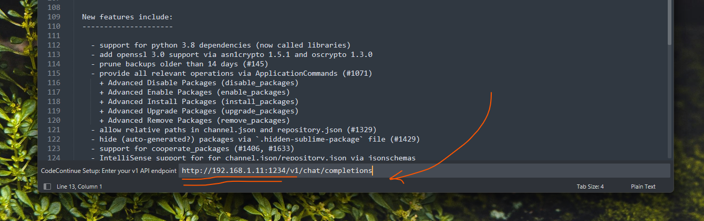
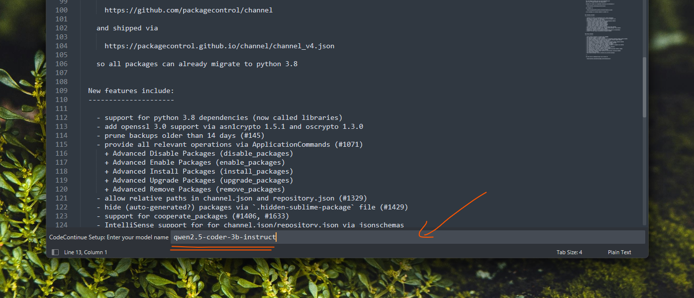
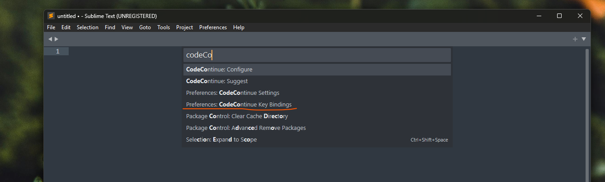
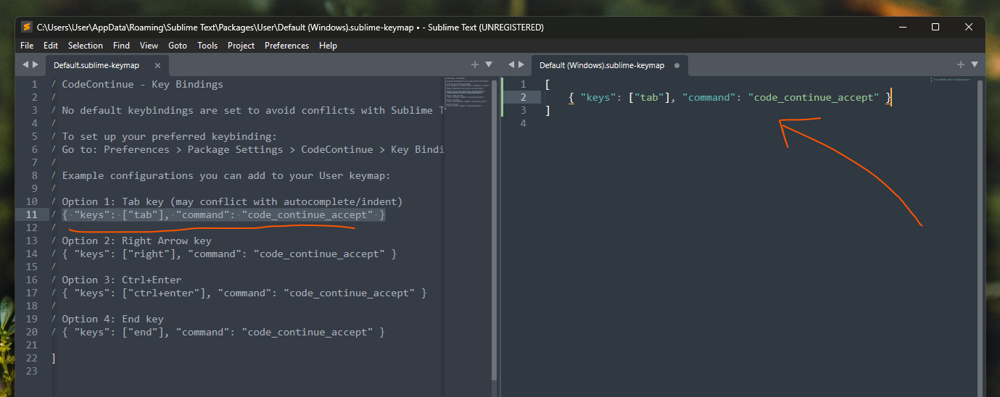

# CodeContinue - AI Code Completion for Sublime Text


An LLM-powered Sublime Text plugin that provides intelligent inline code completion suggestions, in-place code editing, and code chat using OpenAI-compatible or Anthropic APIs. Check out the [CodeContinue blog post here](https://www.orbital.net.in/blog/codecontinue-llm-powered-sublime-text-autocomplete).

## Features

- **Fast Inline Code Completion**: Fill-In-The-Middle (FIM) and suffix-aware bidirectional context slicing with automatic suffix deduplication for clean inline autocompletion.
- **Real-Time Streaming Chat**: Select code >> right-click >> **CodeContinue: Chat about Selection** to discuss code in an interactive split-view Markdown panel with live token streaming (Server-Sent Events).
- **Interactive In-Place Edit & Diff Review**: Select code >> right-click >> **CodeContinue: Edit Selection** to rewrite code using natural language instructions. Review proposed changes as a unified diff in a dedicated tab before applying.
- **1-Click Quick Action Presets**: Instant right-click context menu and command palette presets:
  - *Explain Selection* (detailed logic breakdown, edge cases, complexity)
  - *Find Bugs & Vulnerabilities* (code review for bugs, bottlenecks, and security issues)
  - *Generate Unit Tests* (comprehensive unit tests with edge-case coverage)
  - *Add Docstrings & Types* (in-place type annotations and docstrings)
  - *Optimize & Clean Code* (in-place refactoring for readability and performance)
- **Dual-Engine Architecture**: Mix-and-match models — e.g. use a fast local model for instant inline completions and a powerful cloud model (Claude 3.5 Sonnet or GPT-4o) for chat and editing.
- **Status Bar Widget & Quick Model Switcher**: Live status indicator in Sublime Text's status bar showing the active model and completion activity, plus `Ctrl+Shift+P` >> **CodeContinue: Switch Model...** to change models on the fly.
- **Automatic Endpoint & Model Discovery**: Paste your server address (e.g. `http://localhost:1234` or `https://api.openai.com`); CodeContinue automatically normalizes the URL and detects available models from `/v1/models`.
- **Multi-Provider Support**: Works out-of-the-box with OpenAI, Anthropic, LM Studio, Ollama, vLLM, and local OpenAI-compatible servers.
- **Flexible Keyboard Shortcuts**: Customizable keybindings (e.g. `Enter` to suggest, `Tab` or `Ctrl+Enter` to accept).

## Installation

### Option 1: Install via Package Control (Recommended)

1. Open the command palette via `Ctrl + Shift + P` (or `Cmd + Shift + P` on macOS).
2. Type `Package Control: Install Package` and press Enter.
3. Search for `CodeContinue` and press Enter to install.
4. **Configure CodeContinue**:
   - The setup wizard appears automatically on first run (or run `Ctrl+Shift+P` >> `CodeContinue: Configure` anytime).
   - Follow the step-by-step prompts:
     1. **Completion Engine**: Endpoint URL & model (auto-detects models from your server).
     2. **Dual-Engine Chat**: Chat endpoint URL & model (press Enter to inherit completion endpoint or connect cloud APIs like Claude/OpenAI).
     3. **1-Click Keybindings**: Installs the recommended shortcuts (`Ctrl+Enter` to suggest, `Tab` to accept, `Esc` to dismiss) directly into your User keymap without conflicts.




### Key Bindings
The setup wizard (`CodeContinue: Configure`) installs the recommended keybindings automatically with one click. If you skipped this or wish to customize shortcuts manually:

1. Open the command palette (`Ctrl + Shift + P` on Windows/Linux or `Cmd + Shift + P` on macOS).
2. Type `Preferences: CodeContinue Key Bindings` and press Enter.
3. This opens a split view. Copy your preferred keybinding configuration from the **left side** (Default template) and paste it into the **right side** (User keymap file) inside the `[ ... ]` list, then save (`Ctrl + S` / `Cmd + S`):

```json
[
    // 1. Suggest on-demand with Ctrl+Enter:
    { "keys": ["ctrl+enter"], "command": "code_continue_suggest" },

    // 2. Accept suggestion with Tab (only triggers when a suggestion is visible):
    {
        "keys": ["tab"],
        "command": "code_continue_accept",
        "context": [
            { "key": "code_continue_visible", "operator": "equal", "operand": true }
        ]
    },

    // 3. Dismiss suggestion:
    {
        "keys": ["escape"],
        "command": "code_continue_dismiss",
        "context": [
            { "key": "code_continue_visible", "operator": "equal", "operand": true }
        ]
    }
]
```

Or if you prefer a single unified key (`Ctrl+Enter` for both suggest and accept):
```json
[
    {
        "keys": ["ctrl+enter"],
        "command": "code_continue_accept",
        "context": [
            { "key": "code_continue_visible", "operator": "equal", "operand": true }
        ]
    },
    { "keys": ["ctrl+enter"], "command": "code_continue_suggest" }
]
```





### Option 2: Manual Install (For Developers)


<details>
<summary>Click to view manual installation options</summary>

1. **Python CLI Installer**

```bash
python tools/install.py
```
Interactive command-line installer with auto-detection, connectivity pre-flight check, and dynamic model discovery.

2. **GUI Installer**
   
```bash
python tools/install_gui.py
```
Cross-platform Tkinter graphical installer with automatic model detection and customizable configuration.

</details>

## Configuration
<details>
<summary>Click to expand configuration options</summary>

Settings are saved automatically in `Packages/User/CodeContinue.sublime-settings`. Reconfigure anytime via `Ctrl+Shift+P` >> `CodeContinue: Configure` or switch models via `Ctrl+Shift+P` >> `CodeContinue: Switch Model...`.

- **endpoint**: Your API endpoint URL (default: `http://localhost:8000/v1/chat/completions`) - **Required**
  - Local Server (Ollama / LM Studio / vLLM): `http://localhost:8000` (or `http://localhost:8000/v1/chat/completions`)
  - OpenAI: `https://api.openai.com` (or `https://api.openai.com/v1/chat/completions`)
  - Anthropic: `https://api.anthropic.com` (or `https://api.anthropic.com/v1/messages`)

- **model**: The model name for completions - **Required**
  - Examples: `qwen2.5-coder:1.5b`, `gpt-4o`, `claude-3-5-sonnet-20241022`

- **api_key**: Authentication key (optional)
  - Required for cloud providers (e.g. `sk-...` for OpenAI, `sk-ant-...` for Anthropic).
  - Leave blank for local endpoints that do not require auth.

- **chat_endpoint** / **chat_model** / **chat_api_key**: Optional Dual-Engine overrides for Chat.
  - Allows using a different model for chat (e.g. `claude-3-5-sonnet-20241022`) while keeping a fast local model for completions.
  - If omitted, Chat inherits the global `endpoint`, `model`, and `api_key`.

- **edit_endpoint** / **edit_model** / **edit_api_key**: Optional Dual-Engine overrides for Edit Selection.
  - Allows using a different model for code refactoring (e.g. `gpt-4o`).
  - If omitted, Edit inherits the global `endpoint`, `model`, and `api_key`.

- **stream**: Stream chat responses in real-time using SSE (default: `true`).

- **status_bar**: Show active model name and suggestion activity in Sublime Text status bar (default: `true`).

- **confirm_edits**: Require confirmation and unified diff review before applying code edits (default: `true`).

- **max_context_lines**: Number of surrounding code lines sent to the model (default: `30`).

- **timeout_ms**: Request timeout in milliseconds (default: `30000`).

- **trigger_language**: Array of language scopes to enable completion for (e.g. `["python", "cpp", "javascript", "typescript", "go", "rust"]`).

- **auto_suggest_on_enter**: Automatically trigger code suggestions on every Enter / newline press (default: `false`). When `false`, suggestions are only requested on-demand via your shortcut (e.g. `Ctrl+Enter`) or Command Palette.

- **system_prompt**: Custom system prompt for inline completions.
  - Leave blank (`""`) to use the built-in default expert prompt.
  - Set a custom prompt to tune smaller models or suppress docstrings/comments.

- **debug**: Enable debug logging (default: `false`).
  - Set to `true` to view detailed request/response logs in `View >> Show Console`.

</details>

## Available Commands

Access these commands from the Command Palette (`Ctrl+Shift+P` / `Cmd+Shift+P`) or right-click context menu:

| Command | Context Menu | Description |
| :--- | :--- | :--- |
| `CodeContinue: Suggest` | — | Trigger code completion at cursor |
| `CodeContinue: Dismiss Suggestion` | — | Dismiss currently visible code suggestion |
| `CodeContinue: Switch Model...` | — | Switch model on the fly (Global, Chat, or Edit) |
| `CodeContinue: Configure` | — | Launch setup wizard to reconfigure endpoints and keys |
| `CodeContinue: Chat about Selection` | ✓ | Open real-time streaming split chat for selected code |
| `CodeContinue: Explain Selection` | ✓ | Preset: Break down logic, edge cases, and complexity in chat |
| `CodeContinue: Find Bugs & Vulnerabilities` | ✓ | Preset: Analyze code for bugs, bottlenecks, and security issues |
| `CodeContinue: Generate Unit Tests` | ✓ | Preset: Generate comprehensive unit tests with edge-case coverage |
| `CodeContinue: Edit Selection` | ✓ | Prompt for instruction and rewrite selected code inline |
| `CodeContinue: Add Docstrings & Types` | ✓ | Preset: Add clean docstrings and type annotations inline |
| `CodeContinue: Optimize & Clean Code` | ✓ | Preset: Refactor code for readability, performance, and style |
| `Preferences: CodeContinue Settings` | — | Open user and default settings in a split view |
| `Preferences: CodeContinue Key Bindings` | — | Open keybinding configuration in a split view |

## Requirements

- Sublime Text 4
- Python 3.8+ (bundled with Sublime Text 4)
- Access to a local LLM runner (LM Studio, Ollama, vLLM) or a cloud API (OpenAI, Anthropic, etc.)

## Troubleshooting

<details>
<summary>Click to expand troubleshooting tips</summary>

### Setup wizard not appearing
- Restart Sublime Text: `File >> Exit`, then reopen.
- Manually run: `Preferences >> Package Settings >> CodeContinue >> Settings` or `Ctrl+Shift+P` >> `CodeContinue: Configure`.

### Suggestions not appearing
- Check that the current file's syntax matches an entry in `trigger_language`.
- Verify your API endpoint is accessible.
- Enable debug logging (`"debug": true`) and check `View >> Show Console`.
- Make sure keybindings are configured in `Preferences: CodeContinue Key Bindings`.

### Timeout errors
- Increase `timeout_ms` in settings (e.g. `45000` for larger local models).
- Check that your local LLM server is running and responding.

### Authentication or connection errors
- Verify your API key is correct.
- For local servers (LM Studio / Ollama), ensure the local server is started and listening on the configured port.

</details>

## Advanced Configuration Examples

<details>
<summary>Click to expand provider configuration examples</summary>

**Local LM Studio:**
```json
{
    "endpoint": "http://localhost:1234/v1/chat/completions",
    "model": "qwen2.5-coder-3b-instruct"
}
```

**Local Ollama:**
```json
{
    "endpoint": "http://localhost:11434/v1/chat/completions",
    "model": "qwen2.5-coder:3b"
}
```

**OpenAI:**
```json
{
    "endpoint": "https://api.openai.com/v1/chat/completions",
    "model": "gpt-4o",
    "api_key": "sk-your-openai-key"
}
```

**Anthropic:**
```json
{
    "endpoint": "https://api.anthropic.com/v1/messages",
    "model": "claude-3-5-sonnet-20241022",
    "api_key": "sk-ant-your-anthropic-key"
}
```

**Dual-Engine (Local Autocomplete + Cloud Chat & Edit):**
Run a fast local model for low-latency autocompletions, and route complex chat discussions or code refactoring to Claude 3.5 Sonnet or GPT-4o:
```json
{
    // Fast local engine for inline completions
    "endpoint": "http://localhost:8000/v1/chat/completions",
    "model": "qwen2.5-coder:1.5b",

    // Cloud engine for chat about code
    "chat_endpoint": "https://api.anthropic.com/v1/messages",
    "chat_model": "claude-3-5-sonnet-20241022",
    "chat_api_key": "sk-ant-your-anthropic-key",

    // Cloud engine for in-place code editing / refactoring
    "edit_endpoint": "https://api.openai.com/v1/chat/completions",
    "edit_model": "gpt-4o",
    "edit_api_key": "sk-your-openai-key"
}
```

</details>

## License

See [LICENSE](LICENSE) file for details.

