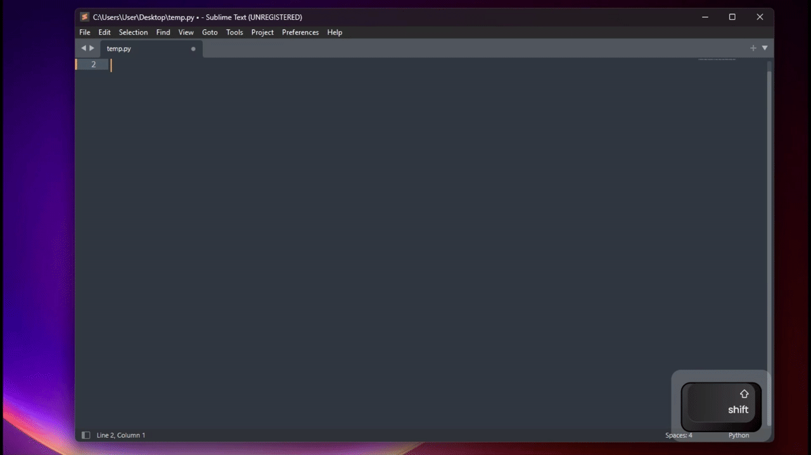

# CodeContinue

> Fast inline code autocomplete, real-time streaming chat, and in-place code editing for Sublime Text 4. Powered by any OpenAI-compatible or Anthropic LLM endpoint.

## Features

- ⚡ **Fast Inline Autocomplete**: Fill-In-The-Middle (FIM) and bidirectional context slicing with automatic suffix deduplication.
- 💬 **Real-Time Streaming Chat**: Discuss code in an interactive split Markdown panel with live token streaming (Server-Sent Events).
- ✏️ **In-Place Edit & Diff Review**: Rewrite code using natural instructions. Inspect proposed changes as a unified diff before applying.
- 🔀 **Dual-Engine Architecture**: Mix and match models (e.g. fast local model for completions, Claude 3.5 Sonnet / GPT-4o for chat and edits).
- 🎯 **1-Click Quick Action Presets**: Right-click selected code to *Explain Selection*, *Find Bugs*, *Generate Unit Tests*, *Add Docstrings & Types*, or *Optimize Code*.
- 🌐 **Universal Provider Support**: Works out of the box with LM Studio, Ollama, vLLM, OpenAI, Anthropic, or any OpenAI-compatible server.

---

## Quick Start

### 1. Install via Package Control
1. In Sublime Text, press `Ctrl+Shift+P` (or `Cmd+Shift+P` on macOS).
2. Select **`Package Control: Install Package`**.
3. Search for **`CodeContinue`** and press `Enter`.

### 2. Run the Setup Wizard
Open the Command Palette (`Ctrl+Shift+P` / `Cmd+Shift+P`) and run **`CodeContinue: Configure`** (or go to `Preferences > Package Settings > CodeContinue > Configure Wizard...`).

The setup wizard will:
1. Connect to your endpoint (e.g. `http://localhost:1234` or `https://api.openai.com`).
2. Auto-detect available models from your server.
3. Install recommended keybindings with a single click.

### 3. Usage
- **Suggest code**: Press `Ctrl+Enter` at any cursor position.
- **Accept suggestion**: Press `Tab` (or `Escape` to dismiss).
- **Chat or Edit**: Select code and right-click to choose **CodeContinue** actions.
- **Switch models**: Press `Ctrl+Shift+P` >> **`CodeContinue: Switch Model...`** to change models on the fly.

---

## Command Reference

Access these commands via `Ctrl+Shift+P` / `Cmd+Shift+P` or the editor right-click menu:

| Command | Menu | Description |
| :--- | :---: | :--- |
| `CodeContinue: Suggest` | — | Trigger code suggestion at cursor (`Ctrl+Enter`) |
| `CodeContinue: Dismiss Suggestion` | — | Dismiss active suggestion (`Escape`) |
| `CodeContinue: Configure` | — | Launch interactive setup wizard |
| `CodeContinue: Switch Model...` | — | Switch active model on the fly |
| `CodeContinue: Chat about Selection` | ✓ | Open streaming chat about highlighted code |
| `CodeContinue: Explain Selection` | ✓ | Break down logic, edge cases, and complexity |
| `CodeContinue: Find Bugs & Vulnerabilities` | ✓ | Scan selection for bugs and security issues |
| `CodeContinue: Generate Unit Tests` | ✓ | Generate tests with edge-case coverage |
| `CodeContinue: Edit Selection` | ✓ | Rewrite selection with instruction & diff preview |
| `CodeContinue: Add Docstrings & Types` | ✓ | Add clean docstrings and type annotations |
| `CodeContinue: Optimize & Clean Code` | ✓ | Refactor code for readability and performance |
| `Preferences: CodeContinue Settings` | — | Open user settings editor |
| `Preferences: CodeContinue Key Bindings` | — | Open keybinding editor |

---

## Keybindings

The setup wizard (`CodeContinue: Configure`) automatically installs the recommended shortcuts into your User keymap without conflicts:

| Action | Shortcut | Command | Condition |
| :--- | :--- | :--- | :--- |
| **Suggest** | `Ctrl+Enter` | `code_continue_suggest` | Always available |
| **Accept** | `Tab` | `code_continue_accept` | Only when suggestion is visible |
| **Dismiss** | `Escape` | `code_continue_dismiss` | Only when suggestion is visible |

To customize your keybindings manually, run `Preferences: CodeContinue Key Bindings`.

---

## Documentation & Guides

- ⚙️ **[Configuration Guide](docs/CONFIGURATION.md)**: Full settings reference, dual-engine setup, and provider recipes (LM Studio, Ollama, OpenAI, Anthropic).
- 🛠️ **[Troubleshooting Guide](docs/TROUBLESHOOTING.md)**: Common fixes, debug logs (`"debug": true`), and resolving manual install overrides.
- 📦 **[Developer Tools & Offline Install](tools/README.md)**: Standalone CLI and GUI installers for development builds.

---

## Requirements

- Sublime Text 4 (Build 4000+)
- Python 3.8+ (bundled with Sublime Text 4)
- Access to an LLM runner (LM Studio, Ollama, vLLM) or API endpoint (OpenAI, Anthropic, etc.)

---

## License

See [LICENSE](LICENSE) for details.
