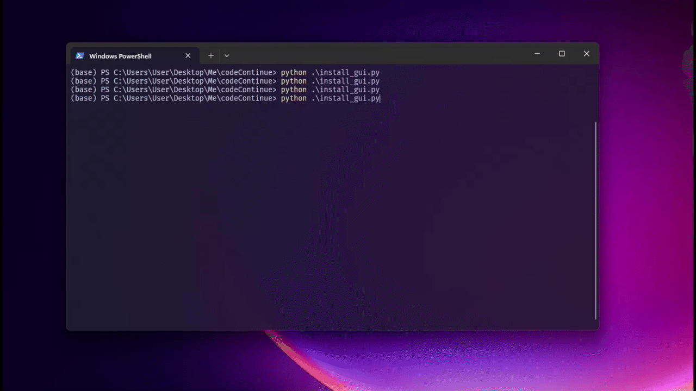

# CodeContinue Manual Installation & Developer Tools

This directory contains standalone installation scripts for manual, offline, or developer setups of CodeContinue.

> **Note:** For standard use, install via [Package Control](https://packagecontrol.io) (`Package Control: Install Package` >> `CodeContinue`). These installer scripts are only needed if you are developing CodeContinue, installing from source, or using an offline environment.



---

## Installation Methods

These scripts are run using your system Python (Python 3.8+) from your terminal or command prompt:

### Option 1: GUI Installer (Recommended for Desktop)

A cross-platform graphical installer built with Tkinter.

```bash
# Run from repository root:
python tools/install_gui.py

# Or from within tools directory:
cd tools
python install_gui.py
```

*Requirements:* `tkinter` (bundled with Python on Windows and macOS; on Linux/Ubuntu run `sudo apt install python3-tk`).

### Option 2: Interactive CLI Installer

A lightweight, terminal-based wizard with zero external dependencies.

```bash
# Run from repository root:
python tools/install.py

# Or from within tools directory:
cd tools
python install.py
```

---

## What the Installers Do

1. **Auto-Detect Sublime Text 4**:
   - Searches standard installation and configuration directories on Windows (`%APPDATA%/Sublime Text`), macOS (`~/Library/Application Support/Sublime Text`), and Linux (`~/.config/sublime-text`).
2. **Verify Connectivity & Discover Models**:
   - Tests connectivity to your local or cloud endpoint (e.g. `http://localhost:8000/v1/chat/completions` or `https://api.openai.com/v1/chat/completions`).
   - Automatically polls available models from `/v1/models` so you can select from a list.
3. **Configure API Settings**:
   - Saves your endpoint, model, and optional API key into `Packages/User/CodeContinue.sublime-settings`.
4. **Configure Keybindings Safely**:
   - Lets you choose your preferred suggestion and acceptance shortcuts (`Ctrl+Enter`, `Tab`, etc.).
   - Adds necessary context conditions (`code_continue_visible: true`) so your editor's default Tab and Esc behaviors are preserved.
5. **Install Package Files**:
   - Copies the plugin files to your Sublime Text `Packages/CodeContinue` folder and sets up the package cleanly.
